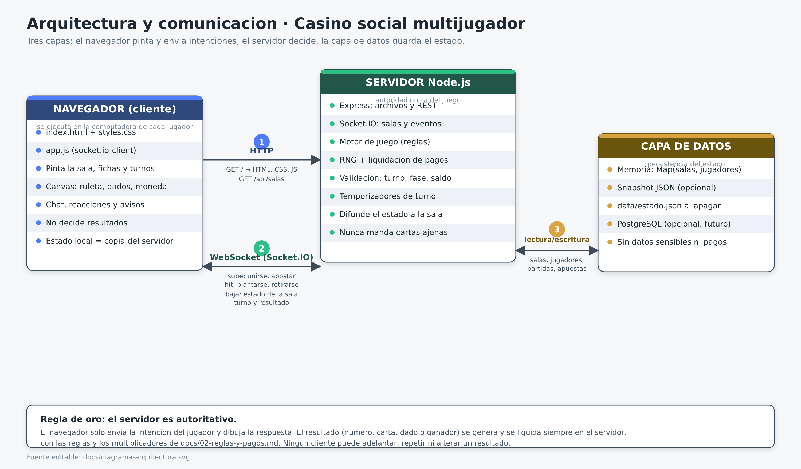
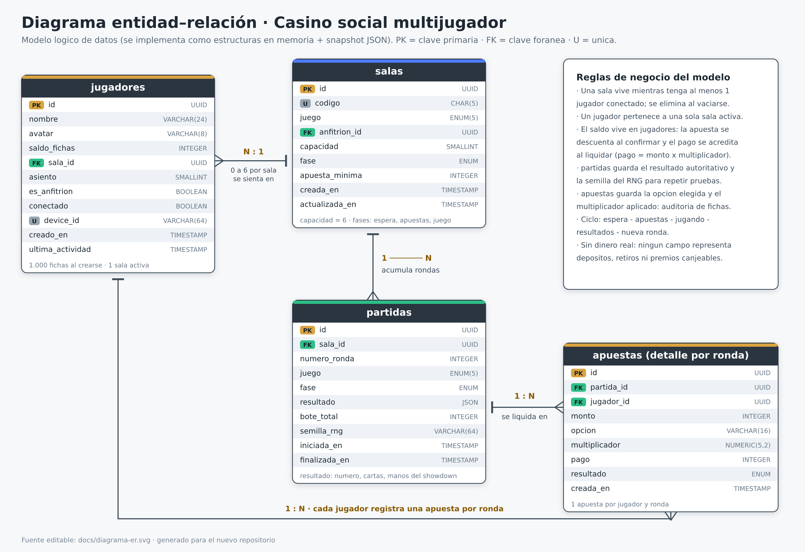

# MonteCristo · Casino social multijugador

> **Aviso:** todas las fichas son **virtuales y recreativas**. No hay dinero real, depósitos,
> retiros, compras ni premios canjeables. Uso recreativo para mayores de 18 años.

Aplicación web para jugar **Cara o Cruz, Dados, Ruleta, Blackjack/21 y Texas Hold'em** con amigos
en tiempo real. Una persona crea una sala, comparte un enlace o un código de 5 caracteres y hasta
**6 jugadores** se sientan en la misma mesa desde su navegador.

---

## Índice

1. [Qué hace el proyecto](#qué-hace-el-proyecto)
2. [Juegos incluidos](#juegos-incluidos)
3. [Tecnologías](#tecnologías)
4. [Requisitos](#requisitos)
5. [Instalación y ejecución](#instalación-y-ejecución)
6. [Despliegue en Render](#despliegue-en-render)
7. [Cómo jugar con otras personas](#cómo-jugar-con-otras-personas)
8. [Scripts disponibles](#scripts-disponibles)
9. [Variables de entorno](#variables-de-entorno)
10. [Estructura del proyecto](#estructura-del-proyecto)
11. [Documentación](#documentación)
12. [Solución de problemas](#solución-de-problemas)
13. [Cómo colaborar](#cómo-colaborar)

---

## Qué hace el proyecto

- **Salas de hasta 6 jugadores**: elige una con cupo en el directorio o entra con enlace o código de 5 caracteres (ej. `K7Q2M`).
- **Estado en tiempo real**: cada apuesta, carta, turno y resultado se ve al instante en la sala.
- **Reloj de turno**: 25 s en blackjack y 30 s en póker. Si nadie responde, **el servidor decide por
  ese jugador** (se planta, o pasa/se retira en póker) y la partida sigue: ninguna mesa se queda
  atorada esperando a una persona.
- **Servidor autoritativo**: los resultados (moneda, dado, ruleta y cartas) los genera y liquida el
  servidor; el navegador solo los muestra.
- **Fichas virtuales**: cada perfil nuevo empieza con **1.000 fichas**. El saldo final de cada
  ronda se guarda en SQLite y se recupera al volver a entrar desde el mismo navegador. La apuesta
  mínima es **10** y los pagos siguen [`docs/02-reglas-y-pagos.md`](docs/02-reglas-y-pagos.md).
- **Chat de sala**: escribe durante la partida y envía con **Enter**. Cada mensaje muestra el nombre del autor y solo llega a su sala.
- **Sin registro**: solo hace falta un nombre y un avatar; no se pide correo ni contraseña.

### Diagramas

| Arquitectura (navegador ⇄ servidor ⇄ datos) | Modelo de datos (entidad–relación) |
| --- | --- |
| [](docs/04-arquitectura.md) | [](docs/03-modelo-de-datos.md) |

---

## Juegos incluidos

| Juego | Ronda | Mínimo de jugadores | Pago principal |
| --- | --- | ---: | --- |
| **Cara o Cruz** | 5–10 s | 1 | Acierto ×2 |
| **Dados** | 5–10 s | 1 | Bajo/alto ×2 · número exacto ×6 |
| **Ruleta** (europea 0–36) | 15–30 s | 1 | Pleno ×36 · color/paridad ×2 |
| **Blackjack / 21** | 1–3 min | 1 | Victoria ×2 · natural ×2,5 · empate ×1 · seguro ×3 |
| **Texas Hold'em** | 2–5 min | 2 | Sin multiplicador: el ganador se lleva el bote (ciegas 10/20) |

Las reglas completas, los multiplicadores y los casos de prueba están en
[`docs/02-reglas-y-pagos.md`](docs/02-reglas-y-pagos.md).

---

## Tecnologías

| Capa | Tecnología | Versión | Para qué |
| --- | --- | --- | --- |
| Lenguaje | **Node.js** | 18 o superior (recomendada 20 LTS) | Ejecuta el servidor y las pruebas |
| Servidor HTTP | **Express** | 4.x | Sirve los archivos estáticos y la API REST |
| Tiempo real | **Socket.IO** | 4.x | WebSocket: salas, eventos y difusión de estado |
| Cliente | **HTML5 + CSS3 + JavaScript** (vanilla, sin framework) | — | Interfaz, avisos y animación local del resultado recibido |
| Pruebas | **node:test** (incluido en Node) | — | Pruebas unitarias de reglas y pagos |
| Persistencia | **SQLite** (`better-sqlite3`) | 11.x | Perfiles, saldos e historial; las salas activas viven en memoria |
| Control de versiones | **Git + GitHub** | — | Repositorio y trabajo en equipo |

> No se necesita una base de datos externa. SQLite usa `data/casino.db` (o la ruta de `DB_FILE`)
> y conserva los saldos al reiniciar si se vuelve a usar el mismo archivo. Las salas activas no
> se restauran. El esquema está documentado en [`docs/03-modelo-de-datos.md`](docs/03-modelo-de-datos.md).

---

## Requisitos

- **Node.js 18 o superior** (incluye `npm`). Compruébalo con `node -v`.
- **npm 9 o superior** (viene con Node).
- **Git**.
- Un navegador actualizado (Chrome, Edge, Firefox o Safari).
- Sistema operativo: **Windows 10/11, macOS o Linux**. La interfaz está pensada para pantallas de
  **1024 px de ancho o más** (computadora de escritorio o laptop).

---

## Instalación y ejecución

Pasos idénticos en Windows, macOS y Linux. Abre una terminal (en Windows: *Símbolo del sistema*,
*PowerShell* o la terminal de Git Bash) y ejecuta:

### 1. Clona el repositorio

```bash
git clone https://github.com/TU-USUARIO/montecristo.git
cd montecristo
```

> Cambia `TU-USUARIO/montecristo` por la URL real del nuevo repositorio.

### 2. Instala las dependencias

```bash
npm install
```

Tarda entre 20 segundos y 2 minutos. Si aparecen avisos de `deprecated`, no son errores.

### 3. Ejecuta el servidor

```bash
npm start
```

Deberías ver algo como:

```
MonteCristo escuchando en http://localhost:3000
```

### 4. Abre la página

Entra a **http://localhost:3000** en tu navegador.

### 5. Crea tu primera sala

1. Pulsa **Crear sala**, escribe tu nombre, elige tu avatar y selecciona un juego.
2. En la mesa verás tus fichas, los seis asientos y el estado de la ronda. Para invitar, usa
   **Copiar código** o **Enlace de invitación**. También se puede pulsar **Entrar** junto a la
   sala en **Salas abiertas**: el inicio muestra juego, anfitrión y ocupación (p. ej., `3/6`).
3. Como anfitrión pulsa **Abrir apuestas**. Elige opción y monto entero (de 10 a tu saldo) y
   pulsa **Confirmar apuesta**. El saldo solo cambia al recibir el estado del servidor. Una
   apuesta confirmada no se puede cambiar ni repetir en esa ronda.
4. En los juegos rápidos el anfitrión lanza con al menos una apuesta confirmada y abre la
   **Nueva ronda** desde resultados. En blackjack y póker se ilumina el asiento en turno y se
   identifica al jugador en el centro. En blackjack la casa juega su mano y liquida cada apuesta.
   En póker el cierre provisional devuelve las aportaciones de quienes siguen en la mesa.
5. Al llegar el resultado aparece el **Balance de la ronda**: el pago incluye la apuesta; el
   **neto** indica la ganancia o pérdida individual. Puedes **Saltar animación** con el botón o
   **Esc**. La animación es local y se omite si tienes activado «reducir movimiento».
6. Abre la pestaña **Chat de sala**, escribe hasta 200 caracteres y pulsa **Enter** o **Enviar
   mensaje**. Puedes seguir los turnos y ver los netos en los asientos sin cerrar el chat.
   [Evidencia de avisos, animación y chat](docs/evidencia/mesa-en-vivo/README.md).

Mantén abierta la pestaña para conservar tu asiento. Salir o desconectarse lo libera; cuando
sale la última persona, el servidor elimina la sala. [Capturas y pruebas del flujo](docs/evidencia/README.md).

### 6. Comprueba el reloj de turno

En blackjack y póker cada turno tiene límite (25 s y 30 s). Si el jugador no manda nada, el
servidor decide por él y la partida continúa. Para verlo sin esperar medio minuto, acorta los
relojes con variables de entorno:

```bash
TIEMPO_TURNO_BLACKJACK_MS=5000 TIEMPO_TURNO_POKER_MS=5000 npm start
```

Con la sala en fase `jugando`, deja pasar los 5 s sin tocar nada: llega el evento
`turno_automatico` (blackjack: `stand` · póker: `check` o `fold`), el turno pasa al siguiente
jugador y `estado_sala` trae la acción marcada como `automatica: true`.

### 7. Juega una ronda de Cara o Cruz

Cara o Cruz ya corre completo en el servidor: cada quien apuesta a `cara` o `cruz`, el anfitrión
manda `lanzar`, **el servidor** lanza la moneda y paga **×2** a quien acertó. Además de usar
los controles de la mesa, se puede inspeccionar el protocolo desde la consola: con el servidor encendido, abre
http://localhost:3000, pulsa `F12` y pega estas líneas una por una.

```js
const mesa = io();                                     // la página ya cargó el cliente de Socket.IO
mesa.onAny((evento, datos) => console.log(evento, datos));
mesa.emit('crear_sala', { nombre: 'Ana', avatar: '🦊', juego: 'coinflip' }, console.log);
mesa.emit('comenzar', console.log);                    // fase: apuestas
mesa.emit('apostar', { monto: 100, opcion: 'cara' }, console.log);   // saldo: 900
mesa.emit('lanzar', console.log);                      // el servidor lanza y liquida
mesa.emit('nueva_ronda', console.log);                 // abre la ronda 2
```

Al lanzar llegan `ronda_iniciada`, `resultado` (`{ resultado: { lado: 'cara' }, apuestas: [...] }`)
y `estado_sala` en fase `resultados`. Con 100 fichas a `cara` el saldo queda en **1.100** si sale
cara y en **900** si sale cruz. Un segundo `lanzar` se rechaza con `RONDA_LIQUIDADA` (la ronda se
paga una sola vez) y solo el anfitrión puede lanzar. Para probar con más gente, abre otra pestaña
y entra con `mesa.emit('entrar_sala', { codigo: 'K7Q2M', nombre: 'Bruno', avatar: '🐼' }, console.log)`.
Sustituye `K7Q2M` por el código que devolvió `crear_sala`.

### 8. Juega una ronda de Ruleta

La ruleta ya se puede jugar por Socket.IO. Apuesta a `rojo`, `negro`, `par` o `impar` (×2),
o a un número exacto de `n:0` a `n:36` (×36). Si sale **0**, pierden las apuestas de color y
paridad: solo cobra quien eligió `n:0`. Los pagos incluyen lo apostado. Las apuestas de rango,
docena y columna quedan fuera de esta implementación.

Para probar el mismo flujo sin la interfaz, abre la consola en la página de inicio con el
servidor encendido y ejecuta estas líneas:

```js
const ruleta = io();
ruleta.on('resultado', console.log);
await ruleta.emitWithAck('crear_sala', { nombre: 'Ana', avatar: '🦊', juego: 'roulette' });
await ruleta.emitWithAck('comenzar');
await ruleta.emitWithAck('apostar', { monto: 100, opcion: 'n:0' });
await ruleta.emitWithAck('lanzar');
await ruleta.emitWithAck('nueva_ronda');
```

El anfitrión lanza un solo giro para toda la sala. Si sale cero, el resultado del giro es
`{ numero: 0, color: 'verde' }` y la apuesta del ejemplo cobra **3.600** fichas
(**+3.500** netas). Si sale otro número, la apuesta cobra 0.

### 9. Probar el reparto y el turno en Blackjack

Desde la consola del navegador en la página de MonteCristo, con el servidor encendido:

```js
const mesa21 = io();
mesa21.on('cartas', ({ cartas, puntos }) => console.log('Tu mano:', cartas, puntos));
mesa21.on('estado_sala', ({ casa }) => { if (casa) console.log('Casa:', casa.cartas, casa.puntos); });
await mesa21.emitWithAck('crear_sala', { nombre: 'Ana', avatar: '🦊', juego: 'blackjack' });
await mesa21.emitWithAck('comenzar');
await mesa21.emitWithAck('apostar', { monto: 100, opcion: 'mano' });
await mesa21.emitWithAck('repartir');
await mesa21.emitWithAck('accion_blackjack', { accion: 'hit' });    // o 'pedir': roba otra carta
await mesa21.emitWithAck('accion_blackjack', { accion: 'stand' });  // o 'plantarse': cierra la mano
```

Cada jugador con apuesta recibe dos cartas en privado. En su turno puede pedir otra carta (`hit` o
`pedir`) tantas veces como quiera mientras no supere **21**, o plantarse (`stand` o `plantarse`)
para ceder el turno. Si al pedir se pasa de **21**, pierde su apuesta de inmediato (`resultado: 'pierde'`,
`pago: 0`) y el turno pasa al siguiente jugador. En la mano pública de la casa, `null` representa
la carta tapada. Al cierre, si queda alguien en pie, la casa pide hasta 17; se revelan sus cartas
y se paga según la comparación. Doblar, dividir y el seguro quedan fuera de este alcance.

### Modo desarrollo

```bash
npm run dev     # reinicia pendiente de cambios (si se configura nodemon) o igual que npm start
npm test        # corre las pruebas de reglas y pagos
npm run lint    # revisa el estilo del código
```

Para detener el servidor pulsa `Ctrl + C` en la terminal.

---

## Despliegue en Render

La v1 usa SQLite para perfiles, saldos e historial, sin una base de datos gestionada. El repositorio
incluye `render.yaml`, que describe el **Web Service Node.js** que Render crea al conectar el repositorio.

### Cómo desplegar

1. Entra en [render.com](https://render.com) → **New** → **Blueprint**.
2. Conecta el repositorio `FremderL/Equipo-4_Montecristo`.
3. Render detecta `render.yaml` y crea el servicio **montecristo** (plan `free`).
4. Espera a que el *build* termine y el *health check* `/health` devuelva `200`.
5. Abre la URL pública `https://<service>.onrender.com`.

### Recursos del blueprint

| Recurso | Archivo | Descripción |
| --- | --- | --- |
| Web Service | `render.yaml` | Express + Socket.IO: interfaz, API y WebSocket en un solo proceso. |
| Ignora build | `.renderignore` | Excluye `node_modules`, `.git` y `.db` del bundle. |
| Node | `.nvmrc` | Fija Node 20 LTS (compatible con `better-sqlite3` v11). |

### Variables de entorno

Render asigna `PORT` automáticamente. El blueprint define `NODE_ENV=production` y `MAX_SALAS=50`;
`DB_FILE` queda en `data/casino.db` (efímero en plan free).

> **Free vs pago:** el plan `free` (Hobby) apaga la instancia tras 15 min sin tráfico y no admite
> discos persistentes. Los perfiles, saldos e historial se pierden cuando Render descarta el archivo
> SQLite. Para conservarlos en producción, activa un disco persistente en `/data` con `DB_FILE=/data/casino.db`;
> ver [`docs/05-despliegue-render.md`](docs/05-despliegue-render.md).

### Evidencia del ticket

1. Captura del dashboard de Render con el servicio **montecristo** en **Live**.
2. Captura del log de *deploy* (`npm ci` → `db:migrar` → arranque) en verde.
3. La URL pública del servicio.
4. Captura de `GET /health` devolviendo `{"ok":true}`.
5. Captura de `npm test` con las pruebas verdes.
6. (Opcional) Captura de la sala creada en el navegador.

---

## Cómo jugar con otras personas

| Escenario | Cómo hacerlo |
| --- | --- |
| **Misma computadora** | Abre dos ventanas o pestañas (una en modo incógnito) en `http://localhost:3000` y entra con el mismo código. |
| **Misma red Wi-Fi** | Quien ejecuta el servidor comparte su IP local: `http://192.168.X.X:3000`. Obtenla con `ipconfig` (Windows) o `ip a` / `ifconfig` (macOS/Linux). |
| **Otra red / internet** | Hay que exponer el puerto 3000 (por ejemplo con [ngrok](https://ngrok.com): `ngrok http 3000`) y compartir la URL que genera. |

> **Acceso:** cualquier persona con acceso al servidor puede encontrar la sala en el directorio y
> entrar mientras tenga cupo. El código es un atajo de invitación, no una contraseña.

---

## Scripts disponibles

| Comando | Qué hace |
| --- | --- |
| `npm start` | Inicia el servidor en el puerto 3000 (o el de `PORT`) |
| `npm run dev` | Igual que `npm start`, pensado para desarrollo |
| `npm test` | Ejecuta las pruebas de reglas, pagos, validaciones e ingreso a salas |
| `npm run test:e2e` | Prueba el directorio, la mesa, las apuestas, los avisos y el chat en Chromium. Ver [preparación y evidencia](docs/evidencia/README.md). |
| `npm run db:migrar` | Aplica `db/schema.sql` sobre SQLite (idempotente; lo usa Render al arrancar) |
| `npm run lint` | Revisa el estilo del código con ESLint |

---

## Variables de entorno

Todas son **opcionales**; sin configurar nada el proyecto funciona.

| Variable | Valor por defecto | Descripción |
| --- | --- | --- |
| `PORT` | `3000` | Puerto en el que escucha el servidor (Render lo asigna automáticamente) |
| `HOST` | `0.0.0.0` | Interfaz donde escucha; `0.0.0.0` la deja disponible para internet |
| `MAX_SALAS` | `50` | Máximo de salas activas simultáneas |
| `DB_FILE` | `data/casino.db` | Archivo SQLite usado por `lib/db.js` y `npm run db:migrar` |
| `TIEMPO_TURNO_BLACKJACK_MS` | `25000` | Límite del turno en blackjack; al vencer, el servidor planta la mano |
| `TIEMPO_TURNO_POKER_MS` | `30000` | Límite del turno en póker; al vencer, el servidor pasa o se retira |

> `GUARDAR_ESTADO` y `LOG_NIVEL` aparecen en DOC-03 como **proyectadas**; el servidor de la
> v1 todavía no las lee. `PORT`, `HOST`, `MAX_SALAS`, `DB_FILE` y los dos `TIEMPO_TURNO_*` sí las
> usa el código.

Ejemplo en Linux/macOS:

```bash
PORT=4000 MAX_SALAS=50 npm start
```

En Windows (PowerShell):

```powershell
$env:PORT=4000; $env:MAX_SALAS="50"; npm start
```

---

## Estructura del proyecto

```
montecristo/
├─ server.js              # Express + Socket.IO: arranque y eventos
├─ package.json
├─ render.yaml            # Blueprint de Render (Web Service Node.js)
├─ .nvmrc                 # Node 20 LTS (Render)
├─ .renderignore          # lo que Render NO sube al build
├─ public/                # todo lo que ve el navegador
│  ├─ index.html, perfil.html        # salón, perfil y mesa
│  ├─ styles.css, mesas.css          # estilos compartidos y de mesa
│  ├─ app.js, juegos-ui.js, salon.js, mesa.js
│  └─ ronda-ui.js, chat-mesa.js       # balance, revelación y conversación de sala
├─ db/
│  ├─ schema.sql          # DDL idempotente: jugadores, salas, partidas, apuestas, historial_rondas
│  └─ migrar.js           # npm run db:migrar
├─ lib/
│  ├─ reglas.js           # constantes y tabla de pagos (DOC-02)
│  ├─ db.js               # conexión única a SQLite (better-sqlite3)
│  ├─ esquema.js          # aplica db/schema.sql una sola vez por conexión
│  ├─ jugadores.js        # crear · buscar por id · actualizar nombre, avatar y saldo
│  ├─ fichas.js           # apuestas, pagos y reembolsos (usa lib/jugadores.js)
│  ├─ historial.js        # historial_rondas: registrar la ronda terminada
│  ├─ codigo-sala.js      # generación y validación de códigos de sala
│  ├─ rng.js              # generador aleatorio con semilla
│  ├─ turno.js            # reloj de turno: decide por quien no responde
│  ├─ lanzamiento.js      # juegos rápidos: lanzar, liquidar y pasar a resultados
│  ├─ salas.js            # estado en memoria (DOC-03)
│  └─ juegos/             # moneda, dado, ruleta y blackjack
├─ data/                  # base SQLite (data/casino.db)
├─ docs/                  # documentación del proyecto (01–05)
├─ e2e/                   # recorridos de la interfaz en Chromium
└─ tests/                 # pruebas con los casos de DOC-02
```

---

## Jugadores: una sola puerta de entrada

Todo el código que necesite jugadores pasa por **`lib/jugadores.js`**; no hay consultas sueltas
sobre la tabla `jugadores` en ningún otro módulo. En las salas, las apuestas descuentan fichas en
memoria. Al cerrar la ronda, el servidor guarda los saldos finales en una transacción de SQLite.
Al crear o entrar en una sala, carga el saldo guardado del perfil sin volver a entregar las 1.000 fichas.

| Función | Qué hace |
| --- | --- |
| `crearJugador({ id?, nombre, avatar?, saldo?, deviceId? })` | Inserta la fila con avatar `🙂` y 1.000 fichas por defecto. |
| `buscarJugadorPorId(id)` · `buscarJugadorPorDispositivo(deviceId)` | Devuelven el jugador o `null`. |
| `actualizarJugador(id, { nombre?, avatar?, saldo? })` | Actualiza los campos indicados y devuelve el jugador. |
| `actualizarNombreJugador` · `actualizarAvatarJugador` · `actualizarSaldoJugador` | Atajos de un solo campo. |
| `ajustarSaldoJugador(id, delta)` | Suma o resta fichas de forma atómica; nunca deja el saldo en negativo. |
| `actualizarSaldosJugadores([{ id, saldo }, ...])` | Guarda juntos los saldos finales de los jugadores. |

## Historial y estadísticas

Las apuestas con resultado definitivo dejan **una fila por jugador y ronda** en `historial_rondas`
(sala, juego, jugador, apuesta, resultado y fecha). La inserta `registrarRondaTerminada()` de
`lib/historial.js` en cuanto la ronda pasa a `resultados`; repetir la llamada no duplica filas.

```js
const { historialDeJugador, estadisticasDeJugador } = require('./lib/historial.js');

historialDeJugador('p_ana', { limite: 10 });     // últimas rondas de Ana
estadisticasDeJugador('p_ana');                  // rondas, ganadas, apostado, cobrado, neto…
```

## Salas: entrar, salir y estado en tiempo real

- **Entrar por código:** `entrar_sala` con el código de 5 caracteres (se acepta en minúsculas o con
  espacios). Si el código no existe se responde `SALA_NO_ENCONTRADA`.
- **Máximo 6 jugadores:** la mesa tiene 6 asientos numerados del 1 al 6; el séptimo recibe
  `SALA_LLENA` y entra en cuanto alguien libere un asiento.
- **Salir:** `salir_sala` libera el asiento, devuelve la apuesta pendiente si la ronda no se había
  lanzado y pasa el rol de anfitrión al siguiente jugador. Si se va el último, la sala desaparece y
  el servidor emite `sala_cerrada`.
- **Estado en tiempo real:** cada cambio (alguien entra, sale o apuesta, y también cada fase, turno y
  resultado) se difunde a **todos** los jugadores de la sala con el evento `estado_sala`, que incluye
  `motivo` (`entrada`, `salida`, `apuesta`, `fase`, `turno`, `resultado`…). Nadie necesita recargar
  la página.

---

## Documentación

| Documento | Contenido |
| --- | --- |
| [`docs/01-alcance-y-requerimientos.md`](docs/01-alcance-y-requerimientos.md) | **Base del proyecto**: juegos incluidos, jugadores por sala y qué puede hacer cada rol. |
| [`docs/02-reglas-y-pagos.md`](docs/02-reglas-y-pagos.md) | Reglas y multiplicadores de cada juego; números oficiales para el código y las pruebas. |
| [`docs/03-modelo-de-datos.md`](docs/03-modelo-de-datos.md) | Modelo entidad–relación: jugadores, salas, partidas y apuestas, con el diagrama y el DDL. |
| [`docs/04-arquitectura.md`](docs/04-arquitectura.md) | Comunicación entre navegador, servidor y datos; endpoints y eventos de Socket.IO. |
| [`docs/05-despliegue-render.md`](docs/05-despliegue-render.md) | **Despliegue**: recursos de Render, planes, variables y checklist de evidencia. |

---

## Solución de problemas

| Problema | Solución |
| --- | --- |
| `node -v` muestra una versión menor a 18 | Instala Node.js 18 o superior desde [nodejs.org](https://nodejs.org) y repite `npm install`. |
| `Error: listen EADDRINUSE :::3000` | El puerto está ocupado: cierra la otra terminal o usa `PORT=4000 npm start`. |
| `npm install` falla por permisos | En Linux/macOS no uses `sudo`; revisa la configuración de npm o borra `node_modules` y reintenta. |
| La página carga pero dice «Desconectado» | Revisa que el servidor siga encendido y que no haya un bloqueador/proxy cerrando el WebSocket. |
| Mis amigos no pueden entrar desde otra red | Necesitas exponer el puerto (ngrok o similar) o desplegar el servidor en un hosting. |
| El navegador muestra una versión vieja de la página | Recarga con `Ctrl + Shift + R` (Windows/Linux) o `Cmd + Shift + R` (macOS). |
| Las fichas volvieron a 1.000 | Comprueba que estás en el mismo navegador y que el servidor conserva el mismo archivo SQLite (`DB_FILE`). Borrar los datos del sitio o abrirlo en incógnito crea otro perfil. |
| La mesa se queda esperando a alguien que no responde | No debería: a los 25 s (blackjack) o 30 s (póker) el servidor juega por esa persona y sigue. Para comprobarlo rápido arranca con `TIEMPO_TURNO_BLACKJACK_MS=5000 npm start`. |

Si algo no está en esta lista, abre un *issue* en el repositorio con el sistema operativo, la
versión de Node (`node -v`) y el mensaje completo del error.

---

## Cómo colaborar

1. Crea una rama desde `main`: `git checkout -b mi-cambio`.
2. Haz commits pequeños y descriptivos (ej. `feat: liquida el seguro del blackjack`).
3. Corre `npm test` antes de subir tu rama.
4. Abre un *pull request* describiendo qué cambiaste y cómo probarlo.
5. Si tu cambio toca reglas o pagos, actualiza primero
   [`docs/02-reglas-y-pagos.md`](docs/02-reglas-y-pagos.md) y ajusta las pruebas al mismo tiempo.

---

## Aviso legal

Proyecto recreativo para mayores de 18 años. Las fichas, apuestas, saldos y resultados son
**completamente virtuales**, no representan dinero ni valor alguno, y no pueden comprarse,
venderse, transferirse ni canjearse. El proyecto no gestiona pagos ni datos financieros.
