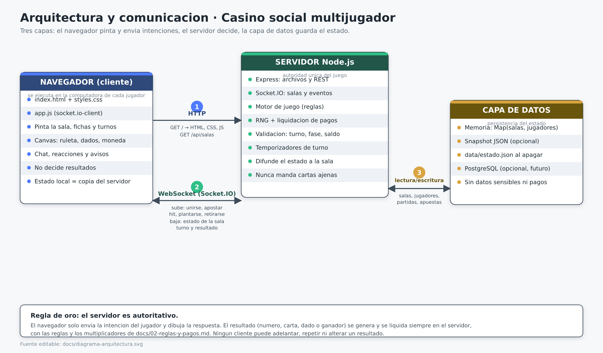

# MonteCristo · Casino social multijugador

> **Aviso:** todas las fichas son **virtuales y recreativas**. No hay dinero real, depósitos,
> retiros, compras ni premios canjeables. Uso recreativo para mayores de 18 años.

Aplicación web para jugar **Cara o Cruz, Dados, Ruleta, Blackjack/21 y Texas Hold'em** con amigos
en tiempo real. Una persona crea una sala, comparte un enlace o un código de 5 caracteres y hasta
**6 jugadores** se sientan en la misma mesa desde su navegador.

---

## Índice

1. [Qué hace el proyecto](#qué-hace-el-proyecto)
2. [Juegos incluidos](#juegos-incluidos)
3. [Tecnologías](#tecnologías)
4. [Requisitos](#requisitos)
5. [Instalación y ejecución](#instalación-y-ejecución)
6. [Despliegue en Render](#despliegue-en-render)
7. [Cómo jugar con otras personas](#cómo-jugar-con-otras-personas)
8. [Scripts disponibles](#scripts-disponibles)
9. [Variables de entorno](#variables-de-entorno)
10. [Estructura del proyecto](#estructura-del-proyecto)
11. [Documentación](#documentación)
12. [Solución de problemas](#solución-de-problemas)
13. [Cómo colaborar](#cómo-colaborar)

---

## Qué hace el proyecto

- **Salas privadas de hasta 6 jugadores** con enlace o código de 5 caracteres (ej. `K7Q2M`).
- **Estado en tiempo real**: cada apuesta, carta, turno y resultado se ve al instante en la sala.
- **Servidor autoritativo**: los resultados (moneda, dado, ruleta y cartas) los genera y liquida el
  servidor; el navegador solo los muestra.
- **Fichas virtuales**: cada jugador empieza con **1.000 fichas**, la apuesta mínima es **10** y los
  pagos siguen la tabla de [`docs/02-reglas-y-pagos.md`](docs/02-reglas-y-pagos.md).
- **Chat de sala** para hablar mientras se juega.
- **Sin registro**: solo hace falta un nombre y un avatar; no se pide correo ni contraseña.

### Diagramas

| Arquitectura (navegador ⇄ servidor ⇄ datos) | Modelo de datos (entidad–relación) |
| --- | --- |
| [](docs/04-arquitectura.md) | [](docs/03-modelo-de-datos.md) |

---

## Juegos incluidos

| Juego | Ronda | Mínimo de jugadores | Pago principal |
| --- | --- | ---: | --- |
| **Cara o Cruz** | 5–10 s | 1 | Acierto ×2 |
| **Dados** | 5–10 s | 1 | Bajo/alto ×2 · número exacto ×6 |
| **Ruleta** (europea 0–36) | 15–30 s | 1 | Pleno ×36 · docena/columna ×3 · color/paridad/rango ×2 |
| **Blackjack / 21** | 1–3 min | 1 | Victoria ×2 · natural ×2,5 · empate ×1 · seguro ×3 |
| **Texas Hold'em** | 2–5 min | 2 | Sin multiplicador: el ganador se lleva el bote (ciegas 10/20) |

Las reglas completas, los multiplicadores y los casos de prueba están en
[`docs/02-reglas-y-pagos.md`](docs/02-reglas-y-pagos.md).

---

## Tecnologías

| Capa | Tecnología | Versión | Para qué |
| --- | --- | --- | --- |
| Lenguaje | **Node.js** | 18 o superior (recomendada 20 LTS) | Ejecuta el servidor y las pruebas |
| Servidor HTTP | **Express** | 4.x | Sirve los archivos estáticos y la API REST |
| Tiempo real | **Socket.IO** | 4.x | WebSocket: salas, eventos y difusión de estado |
| Cliente | **HTML5 + CSS3 + JavaScript** (vanilla, sin framework) | — | Interfaz y animaciones (canvas para la ruleta) |
| Pruebas | **node:test** (incluido en Node) | — | Pruebas unitarias de reglas y pagos |
| Persistencia | **Memoria + archivo JSON** (opcional) | — | Estado de salas y jugadores; **no requiere base de datos** |
| Control de versiones | **Git + GitHub** | — | Repositorio y trabajo en equipo |

> La v1 **no usa base de datos** a propósito: cualquiera del equipo puede clonar el repo y
> ejecutarlo sin instalar ni configurar nada más. El modelo de datos está documentado como esquema
> relacional en [`docs/03-modelo-de-datos.md`](docs/03-modelo-de-datos.md), listo para migrar a
> PostgreSQL más adelante.

---

## Requisitos

- **Node.js 18 o superior** (incluye `npm`). Compruébalo con `node -v`.
- **npm 9 o superior** (viene con Node).
- **Git**.
- Un navegador actualizado (Chrome, Edge, Firefox o Safari).
- Sistema operativo: **Windows 10/11, macOS o Linux**. La interfaz está pensada para pantallas de
  **1024 px de ancho o más** (computadora de escritorio o laptop).

---

## Instalación y ejecución

Pasos idénticos en Windows, macOS y Linux. Abre una terminal (en Windows: *Símbolo del sistema*,
*PowerShell* o la terminal de Git Bash) y ejecuta:

### 1. Clona el repositorio

```bash
git clone https://github.com/TU-USUARIO/montecristo.git
cd montecristo
```

> Cambia `TU-USUARIO/montecristo` por la URL real del nuevo repositorio.

### 2. Instala las dependencias

```bash
npm install
```

Tarda entre 20 segundos y 2 minutos. Si aparecen avisos de `deprecated`, no son errores.

### 3. Ejecuta el servidor

```bash
npm start
```

Deberías ver algo como:

```
MonteCristo escuchando en http://localhost:3000
```

### 4. Abre la página

Entra a **http://localhost:3000** en tu navegador.

### 5. Crea tu primera sala

1. Escribe tu nombre y elige un avatar.
2. Pulsa **Crear sala** y elige el juego.
3. Copia el enlace o el código de 5 caracteres y compártelo.
4. Pulsa **Lanzar** (o **Repartir**) cuando todas las apuestas estén listas.

### Modo desarrollo

```bash
npm run dev     # reinicia pendiente de cambios (si se configura nodemon) o igual que npm start
npm test        # corre las pruebas de reglas y pagos
npm run lint    # revisa el estilo del código
```

Para detener el servidor pulsa `Ctrl + C` en la terminal.

---

## Despliegue en Render

La v1 guarda el estado en memoria y no requiere base de datos gestionada. El repositorio incluye
`render.yaml`, que describe el **Web Service Node.js** que Render crea al conectar el repositorio.

### Cómo desplegar

1. Entra en [render.com](https://render.com) → **New** → **Blueprint**.
2. Conecta el repositorio `FremderL/Equipo-4_Montecristo`.
3. Render detecta `render.yaml` y crea el servicio **montecristo** (plan `free`).
4. Espera a que el *build* termine y el *health check* `/health` devuelva `200`.
5. Abre la URL pública `https://<service>.onrender.com`.

### Recursos del blueprint

| Recurso | Archivo | Descripción |
| --- | --- | --- |
| Web Service | `render.yaml` | Express + Socket.IO: interfaz, API y WebSocket en un solo proceso. |
| Ignora build | `.renderignore` | Excluye `node_modules`, `.git` y `.db` del bundle. |
| Node | `.nvmrc` | Fija Node 20 LTS (compatible con `better-sqlite3` v11). |

### Variables de entorno

Render asigna `PORT` automáticamente. El blueprint define `NODE_ENV=production` y `MAX_SALAS=50`;
`DB_FILE` queda en `data/casino.db` (efímero en plan free).

> **Free vs pago:** el plan `free` (Hobby) apaga la instancia tras 15 min sin tráfico y no admite
> discos persistentes. La v1 funciona así porque guarda el estado en memoria. Para producción
> (plan `starter`/`profesional`), activa el disco persistente en `/data` con `DB_FILE=/data/casino.db`;
> ver [`docs/05-despliegue-render.md`](docs/05-despliegue-render.md).

### Evidencia del ticket

1. Captura del dashboard de Render con el servicio **montecristo** en **Live**.
2. Captura del log de *deploy* (`npm ci` → `db:migrar` → arranque) en verde.
3. La URL pública del servicio.
4. Captura de `GET /health` devolviendo `{"ok":true}`.
5. Captura de `npm test` con las pruebas verdes.
6. (Opcional) Captura de la sala creada en el navegador.

---

## Cómo jugar con otras personas

| Escenario | Cómo hacerlo |
| --- | --- |
| **Misma computadora** | Abre dos ventanas o pestañas (una en modo incógnito) en `http://localhost:3000` y entra con el mismo código. |
| **Misma red Wi-Fi** | Quien ejecuta el servidor comparte su IP local: `http://192.168.X.X:3000`. Obtenla con `ipconfig` (Windows) o `ip a` / `ifconfig` (macOS/Linux). |
| **Otra red / internet** | Hay que exponer el puerto 3000 (por ejemplo con [ngrok](https://ngrok.com): `ngrok http 3000`) y compartir la URL que genera. |

> **Recordatorio:** comparte el enlace solo con las personas que quieres invitar; cualquiera que
> tenga el código puede entrar a la sala mientras exista.

---

## Scripts disponibles

| Comando | Qué hace |
| --- | --- |
| `npm start` | Inicia el servidor en el puerto 3000 (o el de `PORT`) |
| `npm run dev` | Igual que `npm start`, pensado para desarrollo |
| `npm test` | Ejecuta las pruebas de reglas, pagos y validaciones |
| `npm run db:migrar` | Aplica `db/schema.sql` sobre SQLite (idempotente; lo usa Render al arrancar) |
| `npm run lint` | Revisa el estilo del código con ESLint |

---

## Variables de entorno

Todas son **opcionales**; sin configurar nada el proyecto funciona.

| Variable | Valor por defecto | Descripción |
| --- | --- | --- |
| `PORT` | `3000` | Puerto en el que escucha el servidor (Render lo asigna automáticamente) |
| `HOST` | `0.0.0.0` | Interfaz donde escucha; `0.0.0.0` la deja disponible para internet |
| `MAX_SALAS` | `50` | Máximo de salas activas simultáneas |
| `DB_FILE` | `data/casino.db` | Archivo SQLite usado por `lib/db.js` y `npm run db:migrar` |

> `GUARDAR_ESTADO` y `LOG_NIVEL` aparecen en DOC-03 como **proyectadas**; el servidor de la
> v1 todavía no las lee. `PORT`, `HOST`, `MAX_SALAS` y `DB_FILE` sí las usa el código.

Ejemplo en Linux/macOS:

```bash
PORT=4000 MAX_SALAS=50 npm start
```

En Windows (PowerShell):

```powershell
$env:PORT=4000; $env:MAX_SALAS="50"; npm start
```

---

## Estructura del proyecto

```
montecristo/
├─ server.js              # Express + Socket.IO: arranque y eventos
├─ package.json
├─ render.yaml            # Blueprint de Render (Web Service Node.js)
├─ .nvmrc                 # Node 20 LTS (Render)
├─ .renderignore          # lo que Render NO sube al build
├─ public/                # todo lo que ve el navegador
│  ├─ index.html
│  ├─ styles.css
│  └─ app.js
├─ lib/
│  ├─ reglas.js           # constantes y tabla de pagos (DOC-02)
│  ├─ rng.js              # generador aleatorio con semilla
│  ├─ salas.js            # estado en memoria (DOC-03)
│  ├─ snapshot.js         # data/estado.json
│  └─ juegos/             # coinflip · dice · roulette · blackjack · poker
├─ data/                  # snapshot JSON (opcional)
├─ docs/                  # documentación del proyecto (01–05)
└─ tests/                 # pruebas con los casos de DOC-02
```

---

## Documentación

| Documento | Contenido |
| --- | --- |
| [`docs/01-alcance-y-requerimientos.md`](docs/01-alcance-y-requerimientos.md) | **Base del proyecto**: juegos incluidos, jugadores por sala y qué puede hacer cada rol. |
| [`docs/02-reglas-y-pagos.md`](docs/02-reglas-y-pagos.md) | Reglas y multiplicadores de cada juego; números oficiales para el código y las pruebas. |
| [`docs/03-modelo-de-datos.md`](docs/03-modelo-de-datos.md) | Modelo entidad–relación: jugadores, salas, partidas y apuestas, con el diagrama y el DDL. |
| [`docs/04-arquitectura.md`](docs/04-arquitectura.md) | Comunicación entre navegador, servidor y datos; endpoints y eventos de Socket.IO. |
| [`docs/05-despliegue-render.md`](docs/05-despliegue-render.md) | **Despliegue**: recursos de Render, planes, variables y checklist de evidencia. |

---

## Solución de problemas

| Problema | Solución |
| --- | --- |
| `node -v` muestra una versión menor a 18 | Instala Node.js 18 o superior desde [nodejs.org](https://nodejs.org) y repite `npm install`. |
| `Error: listen EADDRINUSE :::3000` | El puerto está ocupado: cierra la otra terminal o usa `PORT=4000 npm start`. |
| `npm install` falla por permisos | En Linux/macOS no uses `sudo`; revisa la configuración de npm o borra `node_modules` y reintenta. |
| La página carga pero dice «Desconectado» | Revisa que el servidor siga encendido y que no haya un bloqueador/proxy cerrando el WebSocket. |
| Mis amigos no pueden entrar desde otra red | Necesitas exponer el puerto (ngrok o similar) o desplegar el servidor en un hosting. |
| El navegador muestra una versión vieja de la página | Recarga con `Ctrl + Shift + R` (Windows/Linux) o `Cmd + Shift + R` (macOS). |
| Las fichas volvieron a 1.000 al reiniciar | Es el comportamiento por defecto; activa `GUARDAR_ESTADO=true` para conservarlas. |

Si algo no está en esta lista, abre un *issue* en el repositorio con el sistema operativo, la
versión de Node (`node -v`) y el mensaje completo del error.

---

## Cómo colaborar

1. Crea una rama desde `main`: `git checkout -b mi-cambio`.
2. Haz commits pequeños y descriptivos (ej. `feat: liquida el seguro del blackjack`).
3. Corre `npm test` antes de subir tu rama.
4. Abre un *pull request* describiendo qué cambiaste y cómo probarlo.
5. Si tu cambio toca reglas o pagos, actualiza primero
   [`docs/02-reglas-y-pagos.md`](docs/02-reglas-y-pagos.md) y ajusta las pruebas al mismo tiempo.

---

## Aviso legal

Proyecto recreativo para mayores de 18 años. Las fichas, apuestas, saldos y resultados son
**completamente virtuales**, no representan dinero ni valor alguno, y no pueden comprarse,
venderse, transferirse ni canjearse. El proyecto no gestiona pagos ni datos financieros.
