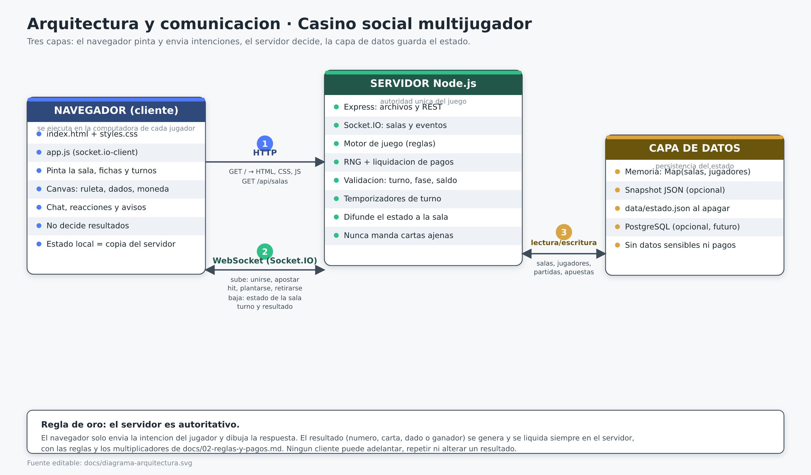

# Ticket 04 · Arquitectura y comunicación (navegador ⇄ servidor ⇄ datos)

| Campo | Valor |
| --- | --- |
| **ID** | DOC-04 |
| **Tipo** | Diseño técnico |
| **Estado** | Propuesta · listo para implementar |
| **Prioridad** | Alta |
| **Depende de** | DOC-01 (alcance), DOC-03 (modelo de datos) |
| **Desbloquea** | Implementación de `server.js` y de los eventos de Socket.IO |
| **Imagen** | `docs/diagrama-arquitectura.png` (fuente editable: `docs/diagrama-arquitectura.svg`) |

---

## 1. Diagrama



---

## 2. Las tres capas

| Capa | Qué es | Qué hace | Qué **no** hace |
| --- | --- | --- | --- |
| **Navegador** | HTML + CSS + JavaScript que se descarga al abrir la página | Pide la página, abre el WebSocket, muestra la sala y manda la intención del jugador («apuesto 100 al rojo») | No calcula resultados, no reparte cartas, no mueve fichas por su cuenta |
| **Servidor Node.js** | Un solo proceso: Express + Socket.IO + motor de juego | Guarda el estado real, valida cada acción, genera el resultado con su RNG, liquida pagos y difunde el nuevo estado a todos | No confía en nada que le mande el cliente |
| **Capa de datos** | Memoria del proceso (+ snapshot JSON opcional) | Guarda salas, jugadores, partidas y apuestas del modelo DOC-03 | No guarda contraseñas, correos ni datos de pago (no existen) |

**Regla de oro:** el servidor es **autoritativo**. El cliente envía intenciones y recibe estados;
el resultado de una ronda se genera una sola vez, en el servidor, y todos los clientes lo reciben.

---

## 3. Cómo se comunican

| # | Canal | Dirección | Para qué | Formato |
| --- | --- | --- | --- | --- |
| 1 | **HTTP** (`GET`) | navegador → servidor | Descargar la aplicación y consultar salas | HTML, CSS, JS, JSON |
| 2 | **WebSocket** (Socket.IO) | navegador ⇄ servidor | Todo lo que pasa dentro de la sala, en tiempo real | Eventos con JSON |
| 3 | **Lectura/escritura** | servidor → datos | Guardar y leer salas, jugadores, partidas y apuestas | Objetos en memoria (o SQL/JSON si se activa persistencia) |

### 3.1 Endpoints HTTP

| Método | Ruta | Respuesta |
| --- | --- | --- |
| `GET` | `/` | Página principal (`index.html`) |
| `GET` | `/sala/:codigo` | Misma página, abre la sala indicada |
| `GET` | `/api/salas` | Lista de salas activas con juego, fase y ocupación |
| `GET` | `/api/salas/:codigo` | Existe o no la sala y cuántos asientos libres tiene |
| `GET` | `/health` | `{ "ok": true }` para verificar que el servidor vive |

### 3.2 Eventos del navegador al servidor

| Evento | Quién lo manda | Datos |
| --- | --- | --- |
| `crear_sala` | Cualquiera | `{ nombre, avatar, juego }` |
| `entrar_sala` | Cualquiera | `{ codigo, nombre, avatar }` |
| `salir_sala` | Jugador | — |
| `comenzar` | **Anfitrión** | — (abre la fase `apuestas`) |
| `apostar` | Jugador | `{ monto, opcion }` (Cara o Cruz: `opcion` es `'cara'` o `'cruz'` · Dados: `'bajo'`, `'alto'` o `'n:1'…'n:6'`) |
| `lanzar` | **Anfitrión** | — (juegos rápidos: el servidor lanza y liquida; lo que mande el cliente se ignora) |
| `repartir` | **Anfitrión** | — (blackjack y póker: arranca el reloj de turno) |
| `accion_blackjack` | Jugador en turno | `{ accion: 'hit' \| 'stand' \| 'double' \| 'split' }` |
| `tomar_seguro` | Jugador (si la casa muestra As) | — |
| `accion_poker` | Jugador en turno | `{ accion: 'fold' \| 'check' \| 'call' \| 'raise', monto }` |
| `nueva_ronda` | **Anfitrión** | — |
| `chat` | Jugador | `{ texto }` |

### 3.3 Eventos del servidor al navegador

| Evento | Cuándo | Datos |
| --- | --- | --- |
| `estado_sala` | Al entrar y después de **cada** cambio | Sala completa: jugadores, fichas, apuestas, fase, turno y `resultado` de la ronda (`null` hasta que se lanza) |
| `ronda_iniciada` | Al lanzar o repartir | `{ numeroRonda, juego }` |
| `cartas` | Solo al dueño de esas cartas | `{ cartas: [...] }` (nunca las ajenas) |
| `turno` | En blackjack y póker, al empezar cada turno y al cerrar la vuelta | `{ jugadorId, deadline, tiempoMs, segundosRestantes, posicion, total, activo }`; `jugadorId: null` cuando ya no hay turno |
| `turno_automatico` | Cuando el reloj vence o el jugador se va en su turno | `{ jugadorId, nombre, accion, motivo, mensaje, numeroRonda }` |
| `apuesta_confirmada` | Al confirmar una apuesta | `{ jugadorId, nombre, monto, opcion }` |
| `resultado` | Al liquidar | `{ juego, numeroRonda, resultado, apuestas: [{ jugadorId, nombre, monto, opcion, multiplicador, pago, neto, resultado }] }` |
| `chat_mensaje` | Al escribir en el chat | `{ nombre, texto, hora }` |
| `error` | Cuando una acción se rechaza | `{ mensaje, codigo }` |
| `sala_cerrada` | Al cerrar la sala o quedarse vacía | `{ motivo }` |

Cada evento del cliente se responde con un **acknowledgement**: `{ ok: true }` o
`{ ok: false, error }`. Si llega `ok: false`, la interfaz muestra el mensaje y no cambia nada.
Los eventos sin datos se pueden mandar solo con su ack: `socket.emit('lanzar', ack)`.

**Resultado de un juego rápido.** En Cara o Cruz `resultado` es `{ lado: 'cara' }` o
`{ lado: 'cruz' }`; en Dados es `{ valor: 1 }`…`{ valor: 6 }`. Cada apuesta liquidada trae su
`multiplicador`, el `pago` total (incluye lo apostado), el `neto` (lo que ganó o perdió) y
`resultado: 'gana' | 'pierde' | 'empate'`. Las mismas apuestas, ya liquidadas, van en
`estado_sala`; antes de lanzar esos cuatro campos valen `null`.

| Rechazo de `apostar` / `lanzar` | `error.codigo` |
| --- | --- |
| La opción no existe en el juego (algo distinto de `cara`/`cruz` o de `bajo`/`alto`/`n:1`…`n:6`) | `OPCION_INVALIDA` |
| Se lanza fuera de la fase `apuestas` | `FASE_INVALIDA` |
| Lanza alguien que no es el anfitrión | `SOLO_ANFITRION` |
| Nadie confirmó una apuesta | `SIN_APOSTADORES` |
| La ronda ya se lanzó (segundo `lanzar`) | `RONDA_LIQUIDADA` |
| El juego de la sala no se lanza (blackjack, póker) o su motor aún no existe (ruleta) | `JUEGO_SIN_LANZAMIENTO` · `JUEGO_NO_DISPONIBLE` |

---

## 4. Secuencia de una ronda (juego rápido)

```
Jugador A                Servidor                       Jugador B
   │                         │                              │
   │── apostar {100,'rojo'} ─▶                              │
   │                         │── valida fase, monto, saldo  │
   │                         │── descuenta 100 del saldo    │
   │◀────── ok ──────────────│                              │
   │                         │──── estado_sala ─────────────▶ (ve la apuesta de A)
   │                         │                              │
   │               (anfitrión) lanzar                       │
   │                         │── genera número 17 (RNG)     │
   │                         │── calcula multiplicadores    │
   │                         │── acredita pagos             │
   │◀──── resultado ─────────│─────── resultado ────────────▶
   │◀──── estado_sala ───────│─────── estado_sala ──────────▶
```

Así corren ya **Cara o Cruz** y **Dados**: al recibir `lanzar`, `lib/lanzamiento.js` recorre el motor
de fases (`apuestas → jugando → resultados`) en un solo paso y `lib/juegos/coinflip.js` pone la
moneda (×2) o `lib/juegos/dice.js` tira el dado de 1–6 (×2 en bajo/alto, ×6 al número exacto); antes
de `resultado` se emite `ronda_iniciada`. La ronda es todo o nada: si algo falla antes de pagar, la
sala sigue intacta en `apuestas`. Ruleta usará el mismo camino cuando registre su motor en
`server.js`.

En **blackjack** y **póker** el mismo esquema se repite por turno: el servidor manda `turno`,
espera la acción (o vence el reloj), aplica la jugada y vuelve a difundir `estado_sala`.

---

## 5. Tiempos, reconexión y errores

| Situación | Comportamiento |
| --- | --- |
| Turno sin respuesta (blackjack) | A los 25 s el servidor planta al jugador (`stand`), emite `turno_automatico` y pasa al siguiente |
| Turno sin respuesta (póker) | A los 30 s pasa (`check`) si no hay fichas por igualar; si las hay, se retira (`fold`) |
| Acción que llega después del `deadline` | Se rechaza con `TURNO_VENCIDO`: vale la decisión que el servidor ya tomó |
| Jugador en turno que sale o se desconecta | El servidor aplica la misma decisión automática (`motivo: 'abandono'`) y la mano continúa |
| Jugador que no apuesta en la fase `apuestas` | No entra al orden de turnos; la ronda se juega sin él (el servidor nunca apuesta por nadie) |
| Anfitrión inactivo 60 s | El rol de anfitrión migra al siguiente jugador conectado |
| Desconexión breve | Socket.IO reintenta solo; el jugador conserva asiento y saldo |
| Salida voluntaria | Se libera el asiento; si la ronda no se lanzó, se reembolsa la apuesta |
| Sala vacía | Se elimina la sala y se cancelan sus temporizadores (relojes de turno incluidos) |
| Acción inválida | Se responde `ok:false` con mensaje; el estado no cambia |
| Apagado del servidor | Se cancelan los relojes de turno; si el snapshot está activo, guarda `data/estado.json` y lo recupera al arrancar |

Los límites de turno viven en `lib/reglas.js` (DOC-02 §2) y el reloj en `lib/turno.js`; se pueden
acortar con `TIEMPO_TURNO_BLACKJACK_MS` y `TIEMPO_TURNO_POKER_MS` para probar la mesa.

---

## 6. Seguridad mínima de la v1

1. **Autoridad del servidor:** el cliente nunca envía un resultado, solo una intención.
2. **Validación en cada acción:** fase, turno, monto, saldo y existencia del jugador.
3. **Privacidad de cartas:** `cartas` se emite por socket individual (`socket.emit`), nunca en la
   difusión de la sala.
4. **Idempotencia:** una ronda se liquida una sola vez aunque lleguen dos `lanzar`.
5. **Límites:** máximo 50 salas, 6 jugadores por sala, 200 caracteres por mensaje de chat.
6. **Sin datos sensibles:** no se piden correo, contraseña ni datos de pago.
7. **Aviso permanente** de que las fichas son virtuales y no tienen valor monetario.

---

## 7. Estructura de carpetas propuesta

```
/
├─ server.js              # Express + Socket.IO + arranque
├─ package.json
├─ public/
│  ├─ index.html          # inicio: crear sala / entrar con código
│  ├─ sala.html           # mesa (o vista única manejada por app.js)
│  ├─ styles.css
│  └─ app.js              # socket.io-client, render y animaciones
├─ lib/
│  ├─ reglas.js           # constantes y pagos de DOC-02
│  ├─ rng.js              # generador con semilla
│  ├─ turno.js            # reloj de turno y decisión automática del servidor
│  ├─ lanzamiento.js      # juegos rápidos: lanzar, liquidar a la sala y pasar a resultados
│  ├─ salas.js            # estado en memoria (DOC-03)
│  ├─ snapshot.js         # guardar/cargar data/estado.json
│  └─ juegos/
│     ├─ coinflip.js      # Cara o Cruz: opciones, moneda y pago ×2
│     ├─ dice.js          # Dados: bajo/alto (×2) y número exacto (×6), dado 1–6
│     ├─ roulette.js
│     ├─ blackjack.js
│     └─ poker.js
├─ data/                  # snapshot JSON (opcional, se crea solo)
├─ docs/                  # esta documentación
└─ tests/                 # pruebas con los casos de DOC-02
```

---

## 8. Criterios de aceptación

- [ ] El navegador se conecta por WebSocket y recibe `estado_sala` completo al entrar.
- [ ] Cualquier cambio de estado se difunde a **todos** los clientes de la sala.
- [ ] Ningún cliente recibe cartas de otro jugador antes del showdown o del cierre de la mano.
- [x] Dos `lanzar` seguidos solo liquidan una vez (idempotencia) — `lib/lanzamiento.js` +
      `tests/lanzamiento.test.js`: el segundo se rechaza con `RONDA_LIQUIDADA` y no mueve saldos.
- [ ] Una acción inválida devuelve `ok:false` y no altera saldos ni fase.
- [x] Los relojes de turno aplican la acción automática a los 25 s (blackjack) y 30 s (póker) —
      `lib/turno.js` + `tests/turno.test.js`; también deciden cuando el jugador se va en su turno.
- [ ] Al perder la conexión y volver, el jugador recupera asiento, saldo y apuesta pendiente.
- [ ] `GET /health` responde `{ "ok": true }` mientras el servidor está vivo.
